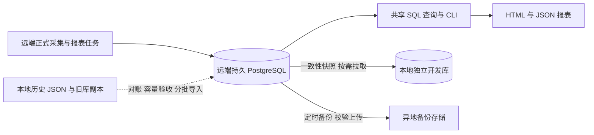

# data-platform 数据平台设计方案

> **v0.5.3** — 设计大纲 + 架构真源（2026-11-20）
> 基于望野 UODE 理念与多源 API 协议；**实现进度/Connector 数量/测试数** → [plans/实施进度总览.md](plans/实施进度总览.md) §2（本文不维护进度表与数字快照）  
> **文档地图** → [README.md](./README.md) · **短入口** → [overview.md](./overview.md)

---

## 零、设计大纲（当前态摘要）

> 本节为**一页纸架构大纲**；字段级速查见 [data-sources.md](./data-sources.md)，HTTP 契约见 [knowledge/数据平台API协议.md](./knowledge/数据平台API协议.md)。

### 0.1 定位与边界

| 维度 | 说明 |
|------|------|
| **角色** | 望野三层架构中的**数据层**：多源采集 → 清洗存储 → RAG 检索 |
| **独立部署** | 独立进程 `:3400`、独立库 `DATA_PLATFORM_DATABASE_URL`（禁止父仓 `DATABASE_URL`） |
| **对外契约** | `SearchProvider` 兼容 HTTP（`POST /api/search`）；engine-core 消费检索结果注入 `knowledgeContext` |
| **不做** | LLM 编排、DAG、引用校验、用户权限、LLM 摘要（均在 engine-core / 主平台） |

### 0.2 六层架构（L1→L6）

```
L1 调度   node-cron + YAML sources.yml → Scheduler.trigger
L2 采集   BaseConnector 生态 → RawDocument（不可变 JSONB；数量与清单见实施进度 §2.1）
L3 存储   PostgreSQL 16 + pgvector（向量与关系数据同库）
L4 处理   dedup → 富化/全文补全 → chunk → embed
L5 RAG     hybridSearch（pgvector 语义 + tsvector 关键词 → RRF）
L6 API     Fastify：/api/search · /api/sources · /api/admin/*
```

数据主路径：`调度 → Connector.collect → dedup → postProcess → embedDocuments → document_chunks → hybridSearch → API`。

### 0.3 实现快照（指针表 · 数字唯一归属实施进度 §2）

> 本表**不维护具体数字**（防双头漂移）；每行指向实施进度总览的唯一真源小节。

| 项 | 现状口径 | 唯一数字真源 |
|----|----------|--------------|
| Connector 运行时（实体 + 虚拟行业源） | 已注册 + Legacy 占位 | [实施进度 §2.1](plans/实施进度总览.md#21-connector-运行时) |
| 定时采集（cron 开/关分层） | YAML `sources.yml` 对齐 | [实施进度 §2.1](plans/实施进度总览.md#21-connector-运行时) |
| 迁移 | `001` 起连续编号至当前 HEAD | [实施进度 §2.4](plans/实施进度总览.md#24-存储与-rag) |
| CLI（通用 / per-source / 行业） | `src/cli/index.ts` 命令表 | [实施进度 §2.3](plans/实施进度总览.md#23-cli) |
| 测试（L0 / I 轨分层） | L0 单元 + L2-fast 闭环 | [实施进度 §2.5](plans/实施进度总览.md#25-测试) |
| 下一动作 | 波次 10（运维启用 + 父仓对接） | [实施进度 §4.10](plans/实施进度总览.md#410-波次-10运维启用--父仓对接--p1-重评估-2026-05-21) |

### 0.4 模块地图（代码 ↔ 设计章节）

| 能力 | 路径 | 设计 |
|------|------|------|
| Connector 框架 | `src/connectors/` · `bootstrap.ts` | [§四](#四connector-系统) |
| 配置 v1.1 | `src/config/` · `config/sources.yml` | [plans/数据源配置-interface-profile实施方案.md](plans/数据源配置-interface-profile实施方案.md) |
| 采集编排 | `src/scheduler/` · `src/collect/` | [§八](#八调度系统) · [plans/采集日志与可观测性设计方案.md](plans/采集日志与可观测性设计方案.md) |
| 处理流水线 | `src/processors/`（dedup · chunk · 全文/Unpaywall 富化） | [§五](#五处理流水线) |
| RAG | `src/rag/`（embed · vectorStore · retriever） | [§五（5.5–5.6）](#五处理流水线) |
| REST API | `src/api/` | [§七](#七api-设计) · [knowledge/数据平台API协议.md](./knowledge/数据平台API协议.md) |
| engine-core 适配 | `src/adapters/engineCore.ts` | [§九](#九与-engine-core-对接) |
| 导出/镜像 D1–D2 | `src/export/` | [plans/原始数据本地导出与镜像方案.md](plans/原始数据本地导出与镜像方案.md) |
| HTTP 溯源 D5 | `src/connectors/provenance/` | 同上 §4.7 |
| 开发/远端数据库边界 | PostgreSQL、开发快照、异地备份 | [§2.4](#24-开发机与远端数据库部署及同步设计) |

### 0.5 横切能力轨

| 轨 | 目标 | 方案 |
|----|------|------|
| **A** | Connector + 流水线 | [数据源接入与RAG构建方案.md](plans/数据源接入与RAG构建方案.md) · 实施进度 §3 A |
| **B** | 配置热更新 / Admin | [外部数据源配置热更新方案.md](plans/外部数据源配置热更新方案.md) |
| **D** | 原始 JSON 导出与镜像 | [原始数据本地导出与镜像方案.md](plans/原始数据本地导出与镜像方案.md) |
| **I** | 子包 collect→search 闭环 | [集成测试最小闭环方案.md](plans/集成测试最小闭环方案.md) · [§十一](#十一集成测试与质量门禁i-轨) |
| **L** | 采集 NDJSON 日志与进度 | [采集日志与可观测性设计方案.md](plans/采集日志与可观测性设计方案.md) |
| **P** | 父仓 HTTP 契约 | [父仓对接集成测试闭环方案.md](plans/父仓对接集成测试闭环方案.md) · [平台接入设计框架.md](plans/平台接入设计框架.md) |

### 0.6 Phase 路线图

> 下表是 **2026-05-22 快照**（仅为阅读上下文；**真源** → [实施进度总览 §2](plans/实施进度总览.md) / §4，数字以真源为准）。

| Phase | 目标 | 快照状态 |
|-------|------|----------|
| **1** MVP 骨架（3 源闭环 → 扩展） | PG + 搜索 API + Scheduler | ✅ |
| **2** RAG（pgvector + 混合检索 + 分块） | Embedding 多后端 | ✅ |
| **2+** 多源波次 5a–9 | Connector 生态扩展 · D5 · 全文加深（数量见实施进度 §2.1） | ✅ 2026-05-21 |
| **3** 知识图谱（Neo4j + 实体关系） | 图检索 | □ |
| **4** 平台化 | 仪表盘 · Webhook · BullMQ | 🟡 调度/监控待做 |

---

## 目录

- [零、设计大纲（当前态摘要）](#零设计大纲当前态摘要)
- [一、项目定位](#一项目定位)
- [二、整体架构](#二整体架构)
- [三、数据模型](#三数据模型)
- [四、Connector 系统](#四connector-系统)
- [五、处理流水线](#五处理流水线)
- [七、API 设计](#七api-设计)
- [八、调度系统](#八调度系统)
- [九、与 engine-core 对接](#九与-engine-core-对接)
- [十、分阶段实施计划](#十分阶段实施计划)
- [十一、集成测试与质量门禁（I 轨）](#十一集成测试与质量门禁i-轨)

---

## 一、项目定位

### 1.1 核心命题

> **构建一个 AI 可以"持续提问、自由探索、廉价试错、真实反馈"的闭环数据基础设施。**

data-platform 是望野三层架构（平台 → engine-core → data-platform）中的**数据层**，职责是：

```
┌──────────────────────────────────────────────┐
│  望野平台 (Next.js)                           │
│  文章展示、用户交互、权限、审计               │
├──────────────────────────────────────────────┤
│  engine-core (DAG 工作流执行器)               │
│  LLM 调用编排、Prompt 渲染、引用管理          │
│  ↑ 通过 SearchProvider contract 消费          │
├──────────────────────────────────────────────┤
│  data-platform (本仓库)                       │
│  多源采集 → 清洗存储 → RAG 检索 → 知识图谱    │
└──────────────────────────────────────────────┘
```

### 1.2 与 engine-core 的边界

| 职责 | engine-core | data-platform |
|------|-------------|---------------|
| 数据采集 | ❌ | ✅ |
| 数据存储 | ❌ | ✅ |
| 语义检索 (RAG) | ❌ | ✅ |
| 知识图谱 | ❌ | ✅ (Phase 3) |
| 定时/事件调度 | ❌ | ✅ |
| LLM 调用编排 | ✅ | ❌ |
| DAG 工作流执行 | ✅ | ❌ |
| Prompt 渲染 | ✅ | ❌ |
| 引用校验 | ✅ | ❌ |
| LLM 摘要生成 | ✅（summarizeContext 节点） | ❌（不持有 LLM 依赖） |
| 实体/关系抽取 | ✅（LLM 抽取） | ✅（规则/NER 轻量抽取） |

**对接协议**：data-platform 对外暴露 `SearchProvider` 兼容接口（`{ query → {title, url, snippet}[] }`），engine-core 无需改动即可消费。

### 1.3 设计原则

1. **Connector 与存储分离**：Connector 只负责"拿进来"，不直接写数据库
2. **原始数据不可变**：RawDocument 只追加不修改，保证审计可追溯
3. **异步流水线**：采集 → 去重 → 富化 → 分块 → Embedding 独立阶段
4. **多消费者复用**：同一数据集供 engine-core、前端仪表盘、管理员查询消费
5. **先窄后宽**：MVP 3 源跑通闭环，再波次扩展（当前 Connector 数量见 [实施进度 §2.1](plans/实施进度总览.md#21-connector-运行时)）

---

## 二、整体架构

### 2.1 六层架构

```
┌──────────────────────────────────────────────────────────┐
│ L6 API 层       │ REST /search, /sources, /admin        │
├──────────────────────────────────────────────────────────┤
│ L5 RAG 层       │ Embedding → 向量检索 → 重排序         │
├──────────────────────────────────────────────────────────┤
│ L4 处理层       │ 去重 → 富化 → 分块 → Embedding       │
├──────────────────────────────────────────────────────────┤
│ L3 存储层       │ PostgreSQL 16 + pgvector (+ Neo4j Phase3) │
├──────────────────────────────────────────────────────────┤
│ L2 采集层       │ Connector 生态 → 标准化 RawDocument        │
├──────────────────────────────────────────────────────────┤
│ L1 调度层       │ Cron 定时 + Webhook 事件 + 手动触发   │
└──────────────────────────────────────────────────────────┘
```

### 2.2 数据流向

```
调度器 ──→ Connector ──→ RawDocument (PG, 不可变)
                              │
                              ▼
处理器 ──→ 去重(by source+extId) ──→ 富化(实体抽取) ──→ EnrichedDocument (PG)
                              │
                              ▼
分块器 ──→ 文本分块 ──→ Embedding 生成 ──→ document_chunks (pgvector)
                              │
                              ▼
RAG 检索 ──→ 语义搜索 + 关键词 ──→ 混合排序 ──→ API 响应
```

### 2.3 技术选型

| 层 | 技术 | 选型理由 |
|----|------|---------|
| 数据库 | PostgreSQL 16 | 成熟稳定，支持 JSONB，与望野现有基础设施一致 |
| 向量库 | pgvector (PostgreSQL 扩展) | 零新基础设施，混合检索一条 SQL |
| 图数据库 | Neo4j (Phase 3) | 知识图谱建模标准选择 |
| 调度 | node-cron → BullMQ | MVP 简单，生产可靠 |
| HTTP | Fastify | 性能好，TypeScript 生态好 |
| Embedding | Ollama (bge-m3，默认) / Voyage AI / OpenAI | 默认本地 Ollama，多后端可切换 |
| 数据访问 | `pg` 连接池 + 手写 SQL | 迁移在 `src/storage/migrations/`；无 ORM 层 |
| 包管理 | pnpm | 与望野一致 |

### 2.4 开发机与远端数据库部署及同步设计

本节给出建议目标：**远端维护正式数据，本地使用独立可写开发库，按需拉取一致性快照，异地保存恢复备份**。先部署报表持久库，历史语料完成对账与容量验证后再迁入正式采集链。运行盘点、实施顺序与验收状态只记在[实施进度 §4.13](plans/实施进度总览.md#413-开发机与远端数据库部署及同步)。



图中采集任务在存量对账与切换验收后启用；首批仅运行报表任务。本地开发库的修改保留在本地；开发机停机、断网或切换分支均不影响远端提交。正式库只使用 `DATA_PLATFORM_DATABASE_URL`，与望野父库、Authentik 库以及分支测试库分开。

#### 2.4.1 存量数据与正式写入归属

**[问题 1] 当前连接库、历史 JSON 和旧数据卷尚无完整对账**

严重程度 / Severity: 🟡 Warning

这些存储可能覆盖不同时间、源和富化版本；文件数包含重复版本的可能性，不能直接换算为数据库行数。将任一现有副本直接选作全量真源，会遗漏其他副本独有的数据。

**修复 / Fix:** 对当前库做一致性备份；将未使用旧卷复制到隔离环境后检查，保持原卷不变。为历史文件生成清单，按 `(source_id, external_id)` 对照唯一键、内容哈希、采集时间、溯源和行业标签。相同键不同内容保留候选版本，输出冲突与缺口清单，按源批准导入规则。导入使用临时表与目标库新 ID，显式映射文档/任务/分块关联；跨库数值 ID 不作为业务身份。缺失溯源和时间保留缺失标记，不能用导入时刻冒充原始采集时刻。正式采集的写入归属在验收后切换，切换前原有采集链保持独立。

历史小文件按来源和日期打成不可变分片，附带记录清单与校验和，支持分片重试和断点续传；临时上传完成并核验后再标记可导入。记录身份从 JSON 内的业务键读取，文件名只用于定位。完成目标端对账和恢复验收前保留原始文件及旧卷。

本地恢复使用独立持久库：数据库快照分别保存在归档库，JSON 与数据库原始记录进入 `recovery.document_versions`，保留来源、原始 ID、采集时间、内容哈希及信封元数据。按业务键选择采集时间最新的原始版本，同一时刻依次采用当前库、旧库、raw 镜像、export；`document_lineage` 记录目标 ID 与所选版本。`public.raw_documents` 保存该版本原文，非空标题、摘要和全文另在 `field_candidates` 保留候选，`enriched_documents` 提供补充后的查询结果及补充来源，不把历史正文标记成新采集内容。

任务只按来源数据库映射；JSON 中孤立的旧任务 ID 作为原始元数据保留。旧分块全部归档并关联新文档，仅当原始内容与目标版本一致时进入活动分块表，避免将旧向量挂到已变更正文。源配置与水位保留快照，恢复库关闭调度，也不接入应用启动入口；验收结果及连接位置统一记录在[实施进度 §4.13](plans/实施进度总览.md#413-开发机与远端数据库部署及同步)。

#### 2.4.2 远端持久化与容量边界

**[问题 2] 远端验收库的临时生命周期不适合承担正式存储**

严重程度 / Severity: 🟡 Warning

分支测试的 tmpfs 数据库用于可丢弃验收。正式库还需要固定的数据位置、独立网络、资源预算和恢复入口；远端可用磁盘与历史文件体积的差距见实施进度 §4.13。

**修复 / Fix:** 新建正式 PostgreSQL 16 + pgvector 服务，镜像版本与扩展版本固定；建议宿主机目录 `/srv/data-platform/pgdata`，备份暂存 `/srv/data-platform/backups`，均独立于 Git checkout。报表容器经专用 Docker 网络连接数据库，默认不发布数据库端口；管理使用 SSH 和专用只读角色。若需要隧道接入，仅绑定远端回环地址。测试环境继续使用独立卷或 tmpfs。

首批只部署报表任务、报表读模型及所需元数据，报表与 CLI 均调用共享 SQL 查询；全量采集与 Embedding 单独做容量验收。建议起始预算：PG 内存上限 1GiB，新增数据库、WAL、日志和备份暂存合计不超过 5GiB，远端磁盘可用空间至少保留 20GiB；这些是初始配置目标，须通过负载测试校准。历史全量迁入前，实测 JSON 去重后体积、入库膨胀、索引和临时空间、WAL 峰值及增长速度，再决定扩容或增加独立归档存储。压缩传输不能证明入库后空间足够。

数据职责如下：

| 数据类别 | 正式归属 | 本地获取方式 |
|----------|----------|--------------|
| `report_runs` / `report_sources` / `report_items` | 远端报表库维护历史快照 | UI 调试导入报表 JSON；历史行为测试恢复数据库快照 |
| `raw_documents` 与所需源元数据 | 切换验收后的远端正式采集库 | 默认按源/时间选开发数据集；按需完整恢复 |
| `document_chunks` 与向量 | 随对应原始文档及模型版本管理 | 开发数据集可重建；完整恢复保留关联与模型版本 |
| 任务、采集水位、运行时配置审计 | 运行环境各自维护 | 开发副本只作历史参考，不启动正式调度 |
| YAML 与 SQL 迁移 | Git 版本及数据库迁移记录 | 随代码发布；正式运行时配置变更通过受控发布处理 |
| 原始 JSON 归档、日志、报表产物 | 各自目录及独立归档清单 | 依需求拉取；不据此推断完整数据库状态 |
| API Key、数据库密码 | 各环境凭证配置 | 不随开发快照和 Git 传输 |

#### 2.4.3 本地开发如何获得数据

**[问题 3] 可写开发库与持续复制副本的用途不同**

严重程度 / Severity: 🟡 Warning

分支开发需要修改表结构、造测试数据和重建索引。将持续接收正式变更的库直接用于开发，会让本地修改与同步输入相互干扰。

**修复 / Fix:** 默认采用按需快照刷新。小库用 `pg_dump -Fc` 取得同一数据库的一致性快照，经 SSH 拉取并校验，再用 `pg_restore` 恢复到新的本地开发库；不携带正式 owner/ACL，由本地初始化流程赋权。快照附带 PostgreSQL/扩展版本、迁移清单哈希、快照标识与时间范围、表级数量和文件校验和。恢复、迁移及 CLI 冒烟通过后再切换本地连接，旧开发库按保留策略清理。[pg_dump 官方说明](https://www.postgresql.org/docs/16/app-pgdump.html)支持并发使用中的一致性备份；外部文件和集群角色需另行管理。

开发库启动须统一关闭采集、catalog 与权重校准等定时任务，也不自动套用正式采集配置。当前启动入口按 YAML 注册任务，仅修改数据库中的调度开关不足以保证停止，需要补充贯穿 `src/index.ts` 与 CLI `serve` 的启动模式。需要复现线上查询时使用独立只读连接，开发写入仍使用本地库。

数据变大后，增加开发数据集导出：在一个一致性读事务中选择原始记录及外键依赖，记录选择规则、排序与数量上限，默认覆盖不同来源、时间、失败和缺字段案例。完整快照用于恢复演练与故障复现，日常开发不要求复制全部语料。仅导入一份报表 JSON 可调试展示；验证跨快照变化需要按时间导入连续报表或恢复完整快照。

| 机制 | 适用场景 | 本方案选择 |
|------|----------|------------|
| SSH + 只读 SQL/CLI | 临时查看远端真实状态 | 诊断入口，与本地写入分开 |
| `pg_dump` / `pg_restore` | 独立可写开发副本、库级备份 | 初期主方案 |
| 逻辑复制 | 持续更新的专用只读数据镜像 | 有实时需求后另建订阅库，与开发库分开 |
| 物理流复制 | 持续在线的只读备机、故障接管 | 有高可用需求后单独设计 |
| 双端互相同步写入 | 需要解决冲突、标识和删除传播 | 当前不引入；双端采集优先集中入库 |

#### 2.4.4 增量同步的正确性边界

**[问题 4] 现有游标和文件镜像不能覆盖所有数据库变更**

严重程度 / Severity: 🟡 Warning

`insertRawDocuments` 存在更新分支，全文和标签还有独立 patch；`patchRawDocumentJson` 不改变 `fetched_at`。按新增 ID 或采集日期导出会漏掉已有行的部分更新，也没有删除传播。镜像是尽力写入的原始记录副本，无法充当跨表事务日志。

**修复 / Fix:** 首期保持完整快照或可重建开发数据集的语义，不宣称提供无遗漏增量。若需要持续同步，优先为稳定在线的独立只读镜像配置 PostgreSQL 逻辑复制，并管理复制延迟、断连期间 WAL 保留预算及超预算后的重建流程。DDL 与序列值不随逻辑复制传输，必须纳入发布流程；订阅库需要写入时先脱离复制并处理序列。[PostgreSQL 16 逻辑复制限制](https://www.postgresql.org/docs/16/logical-replication-restrictions.html)是此边界的依据。

若两端都必须采集，采用“采集工作节点 → 中央接收入口 → 正式库”：入口校验来源、稳定业务键、请求幂等标识和内容哈希，集中处理版本冲突。离线重传依靠持久队列；如需应用层增量，再引入与业务写入同事务的变更记录、版本和删除标记。此能力独立立项，不把开发库变为第二个正式写入源。

#### 2.4.5 备份、恢复与发布

**[问题 5] 同步副本与可回退备份需要分别维护**

严重程度 / Severity: 🟡 Warning

复制会传播错误更新和删除；同一服务器上的数据目录、程序镜像以及报表 JSON 无法共同构成整库恢复保证。

**修复 / Fix:** 小库初期每小时做一次 custom-format 库级备份，校验后上传异机存储；建议保留最近 24 份小时备份与 7 份日备份，本机仅作有限暂存。配置、数据库角色重建流程、扩展镜像版本、外部原始文件及其清单分别纳入恢复包。备份产物先临时写入，完成校验后发布，失败保留上一份有效备份；异地上传失败与最近成功备份年龄超阈值均告警。开发机可拉取额外副本，正式备份调度不依赖开发机在线。

首期小库建议目标为 RPO（可接受的数据丢失窗口）不超过 2 小时、RTO（恢复服务所需时间）不超过 2 小时，须以异地成功备份时间和恢复演练验证，尚不是运行承诺。每周及重大迁移前在隔离库做恢复，核查表级数量、关联、向量扩展、查询排序和 CLI 导出。后续需要更短恢复点时采用基线备份与连续 WAL 归档，实现 [PITR](https://www.postgresql.org/docs/16/continuous-archiving.html)；不能用 `pg_dump` 代替 WAL 恢复链，也不对运行中的 PGDATA 直接做文件复制来制作一致性备份。

**[问题 6] 镜像发布、数据库迁移和调度切换尚需形成统一流程**

严重程度 / Severity: 🟡 Warning

当前 `cmdMigrate` 按文件重放 SQL，没有已应用版本/校验和登记；应用启动会同步配置并注册 cron。仅替换镜像不能保证数据库兼容，也不能避免两端正式调度重复运行。

**修复 / Fix:** 增加受锁保护的迁移登记与校验，升级顺序为“异地备份验证 → 隔离恢复与迁移测试 → 正式迁移 → CLI 验证 → 镜像与报表切换”。采用兼容新旧代码的增量结构变更；破坏性收缩单独发布。切换正式采集时先停止旧任务、核对水位和在途任务，再只启一个正式调度实例。报表产物使用临时目录生成并验证后发布，失败继续服务上一份；应用回滚只在数据库结构兼容时执行，数据库回退另走恢复流程并核算回退后的数据缺口。

正式库、开发库和集成测试库分别管理。Vitest 仅使用进程环境 `DATA_PLATFORM_TEST_DATABASE_URL`，不自动加载采集 `.env` 或回退 `DATA_PLATFORM_DATABASE_URL`。清理前在固定连接核验实际库名、非管理角色与只读测试标记；URL 参数不得覆盖数据库、角色或 search_path。默认入口仅运行 L0；真实 DB 测试由 `pnpm test:integration:isolated` 创建独立 PG，测试角色仅有测试库内权限，清理限定为明确的 public 业务表或独立测试 schema。实际问题证据与实施状态见实施进度 §4.13.1–§4.13.2。

旧库卷采用离线保留、完整冷备和可移植逻辑备份；先从冷备副本导出，再恢复到独立空库核对内容。原卷不接回正式服务，也不拆删 `pg_wal` 等内部文件。[PostgreSQL 文件级备份要求](https://www.postgresql.org/docs/16/backup-file.html)决定了物理副本须保留完整集群及其一致性状态。独有记录、正文和关联先进入恢复候选，再按业务键与目标库合并；原卷清理放在异地副本和数据合并验收之后，实际产物与处置记录归实施进度 §4.13.2。

**CLI 优先接口草案**：补充 `db inspect`、`db snapshot create`、`db snapshot restore`、`db backup verify`，统一 JSON 输出；快照创建区分完整备份与开发数据集，提供目标环境、数据范围和校验结果。恢复默认进入新开发/测试库，拒绝覆盖正式库；诊断和开发角色无正式写权限。上述命令属于设计草案，现有可用命令仍以[实施进度 §2.3](plans/实施进度总览.md#23-cli)为准。实现先打通备份/恢复/查询的 CLI 闭环，再将状态接入 Web。

| 问题 | 严重度 | 处理状态 |
|------|--------|----------|
| 存量数据与写入归属 | 🟡 Warning | [见实施进度 §4.13](plans/实施进度总览.md#413-开发机与远端数据库部署及同步) |
| 正式持久化与容量 | 🟡 Warning | 同上 |
| 可写开发副本 | 🟡 Warning | 同上 |
| 无遗漏增量 | 🟡 Warning | 同上 |
| 异地备份与恢复 | 🟡 Warning | 同上 |
| 迁移与调度发布 | 🟡 Warning | 同上 |

---

## 三、数据模型

报表查询使用独立快照读模型 `report_runs` / `report_sources` / `report_items`（迁移 `038`）；
保存独立探活/抽样及时间语义，通过 SQL 视图供 CLI 和静态 Web 导出消费。
它与 `raw_documents` 的主采集记录口径分开，详见[报表方案 §3.2.1](plans/数据报表站点设计方案.md#321-源时效排列与-cli-优先)。

### 3.1 核心实体

> 状态标注（2026-10-16 对齐迁移 `001`–`037`）：未标注者均已建表；Phase 3 / 已废弃项见各行。

```
DataSource ──── 数据源注册                              # 已建表 001
  id, name, baseUrl, authType, rateLimit, license, commercialUse, status, createdAt

CollectionJob ──── 采集任务                            # 已建表 001
  id, sourceId, query, status(pending/running/success/failed),
  itemsCollected, errorMessage, startedAt, finishedAt

RawDocument ──── 原始文档 (不可变)                    # 已建表 001；D5 溯源列 010
  id, sourceId, externalId, rawJson(JSONB), fetchedAt, collectionJobId,
  fetchProvenance(JSONB, 可选) ── HTTP 溯源，与 rawJson 独立；见 plans/原始数据本地导出与镜像方案.md §4.7 (D5)
  唯一键: (sourceId, externalId)

EnrichedDocument ──── 富化文档                        # 未单表落地：富化字段并入 raw_json（Phase 3 再评估）
  id, rawDocId, title, abstract, fullText, contentType, language,
  authors[], publishedAt, entities(JSONB), metadata(JSONB), enrichedAt

DocumentChunk ──── 文本分块                           # 已建表 002（pgvector）
  id, docId, chunkIndex, text, tokenCount, embeddingModel

Entity ──── 抽取实体                                  # Phase 3 规划（Neo4j + 抽取）
  id, type(PERSON/ORG/TECH/CONCEPT/…), name, aliases[], metadata(JSONB)

EntityRelation ──── 实体关系                          # Phase 3 规划
  id, fromEntityId, toEntityId, relationType(cites/competes/depends/replaces/…),
  confidence, evidence[], createdAt

CollectionSchedule ──── 定时采集                      # 已建表 001；增量字段 007
  id, sourceId, cronExpr, query, enabled, lastRunAt, nextRunAt

DataSourceAuth ──── 凭证管理 (加密存储)                # 已废弃：凭证仅 process.env（见 AGENTS.md）
  id, sourceId, authType, credentials(encrypted), expiresAt
```

### 3.2 枚举类型

```typescript
// 认证模式（对应数据 API 协议 §7.2）
enum AuthType {
  QUERY_PARAM_KEY = "query_param_key",     // FRED, PubMed, PatentsView
  HEADER_BEARER = "header_bearer",         // GitHub, Reddit, EPO OPS
  HEADER_CUSTOM = "header_custom",         // Semantic Scholar (x-api-key)
  POLITE_ID = "polite_id",                 // CrossRef (mailto), SEC EDGAR (User-Agent)
  OAUTH2 = "oauth2",                       // EPO OPS, Google BigQuery
  NONE = "none",                           // arXiv, World Bank, Hacker News
}

// 分页方式（对应数据 API 协议 §7.3）
enum PaginationType {
  OFFSET = "offset",                       // OpenAlex, World Bank
  CURSOR = "cursor",                       // OpenAlex(大数据), CrossRef
  RESUMPTION_TOKEN = "resumption_token",  // arXiv OAI-PMH
  WEBENV = "webenv",                       // PubMed E-utils
  LINK_HEADER = "link_header",            // GitHub
}

// 实体类型
enum EntityType {
  PERSON = "PERSON",
  ORGANIZATION = "ORGANIZATION",
  TECHNOLOGY = "TECHNOLOGY",
  CONCEPT = "CONCEPT",
  PRODUCT = "PRODUCT",
  LOCATION = "LOCATION",
  EVENT = "EVENT",
}

// 关系类型
enum RelationType {
  CITES = "cites",
  COMPETES = "competes",
  DEPENDS_ON = "depends_on",
  REPLACES = "replaces",
  FUNDED_BY = "funded_by",
  ACQUIRED_BY = "acquired_by",
  COLLABORATES_WITH = "collaborates_with",
}
```

### 3.3 数据许可台账

每条数据记录必须追溯许可信息（对应数据 API 协议 §7.5 台账模板）：

```typescript
interface DataProvenance {
  sourceId: string;           // 如 "openalex_works"
  platform: string;           // 如 "OpenAlex"
  baseUrl: string;            // 如 "https://api.openalex.org"
  accessType: "free" | "free_limited" | "commercial" | "academic_only";
  authMethod: AuthType;
  license: string;            // 如 "CC0", "CC BY 4.0"
  commercialUse: boolean;
  rateLimit: string;          // 如 "100000/day"
  dataFreshness: string;      // 如 "daily"
  legalReview: "pending" | "approved" | "rejected";
}
```

---

## 四、Connector 系统

### 4.1 BaseConnector 设计

所有 Connector 继承 `BaseConnector`，框架统一管理速率控制、重试、分页：

```typescript
abstract class BaseConnector {
  abstract readonly id: string;
  abstract readonly baseUrl: string;
  abstract readonly license: string;
  abstract readonly commercialUse: boolean;

  // 速率控制（对应数据 API 协议 §7.4）
  protected rateLimiter: RateLimiter;

  // 指数退避重试
  protected async fetchWithRetry(url: string, options: RequestInit): Promise<Response>;

  // 分页游走（自动处理 offset/cursor/resumptionToken）
  protected async *paginate(params: PaginateParams): AsyncGenerator<RawDocument>;

  // 子类实现
  abstract search(query: string, opts?: SearchOptions): Promise<SearchResult[]>;
  abstract fetchById(externalId: string): Promise<RawDocument | null>;
  abstract collect(params: CollectParams): AsyncGenerator<RawDocument>;
}
```

### 4.2 速率控制器

```typescript
class RateLimiter {
  private tokens: number;
  private lastRefill: number;

  constructor(
    private maxTokens: number,     // 如 100000/day → 按秒折算
    private refillRate: number,    // tokens/second
    private minInterval: number,   // 最小请求间隔 (ms)
  ) {}

  async acquire(): Promise<void> {
    // 令牌桶 + 最小间隔保证
    // 令牌不足时 sleep 等待
  }
}

class ExponentialBackoff {
  constructor(
    private maxRetries: number = 5,
    private baseDelay: number = 1000,
  ) {}

  async execute<T>(fn: () => Promise<T>): Promise<T> {
    // 429/5xx → 指数退避重试
    // delay = baseDelay * 2^attempt
  }
}
```

### 4.3 首批 MVP 源（Phase 1）

| Connector | 数据 | URL | 认证 | 速率 | 许可 |
|-----------|------|-----|------|------|------|
| `OpenAlexConnector` | 2.4亿论文元数据 | `api.openalex.org` | API Key (Query，可选) | 100K/天 | CC0 |
| `CrossRefConnector` | DOI 元数据 + 引文 | `api.crossref.org` | Polite mailto | polite ≈50/s | varies（逐条 metadata） |
| `WorldBankConnector` | 全球发展指标 | `api.worldbank.org` | 无需 | 无明确限制 | CC BY |

> Semantic Scholar（A4）与 PatentsView 为后续波次加入，见 §4.4 与 [data-sources.md](./data-sources.md)。

### 4.4 扩展 Connector 清单（Phase 2+）

Connector 实现速查见 [data-sources.md](./data-sources.md)；对外 HTTP 契约见 [knowledge/数据平台API协议.md](./knowledge/数据平台API协议.md)：

**学术**：PubMed E-utilities, CrossRef, arXiv OAI-PMH
**专利**：EPO OPS, Google Patents BigQuery
**金融**：SEC EDGAR, FRED, Yahoo Finance
**政府**：World Bank, ClinicalTrials.gov
**社交/技术**：GitHub, Hacker News, Reddit

### 4.5 Connector 注册与工厂

```typescript
// src/connectors/index.ts
const connectorRegistry: Map<string, () => BaseConnector> = new Map();

export function registerConnector(id: string, factory: () => BaseConnector): void;
export function createConnector(id: string, config: ConnectorConfig): BaseConnector;
export function listConnectors(): ConnectorMeta[];

// 启动时自动注册
registerConnector("openalex", () => new OpenAlexConnector({ apiKey: env.OPENALEX_KEY }));
registerConnector("semanticscholar", () => new SemanticScholarConnector({ apiKey: env.S2_KEY }));
registerConnector("patentsview", () => new PatentsViewConnector({ apiKey: env.USPTO_ODP_KEY }));
```

---

## 五、处理流水线

> **本地原始 JSON 副本**（可选）：PostgreSQL 仍为真源；事后 `pnpm cli export`（D1）与采集镜像 `DATA_PLATFORM_RAW_MIRROR`（D2）见 [plans/原始数据本地导出与镜像方案.md](./plans/原始数据本地导出与镜像方案.md)。

### 5.1 阶段定义

```
采集完成 → [Stage 1: 去重] → [Stage 2: 富化] → [Stage 3: 分块] → [Stage 4: Embedding]
              └─ (可选) 镜像写盘 D2
```

### 5.2 Stage 1：去重

```typescript
// 以 (sourceId, externalId) 为唯一键
// 新文档 → 写入 RawDocument
// 已有文档 → 检查 fetchedAt 是否超过 freshness 阈值，超过则更新
async function dedup(docs: RawDocument[]): Promise<{
  newDocs: RawDocument[];
  updatedDocs: RawDocument[];
  skippedDocs: number;
}>;
```

### 5.3 Stage 2：富化

```typescript
// 从 RawDocument.rawJson 中提取结构化字段
// 对文本型文档（论文、专利、新闻）用 LLM 做实体抽取
async function enrich(doc: RawDocument): Promise<EnrichedDocument> {
  return {
    rawDocId: doc.id,
    title: extractTitle(doc.rawJson),
    abstract: extractAbstract(doc.rawJson),
    fullText: extractFullText(doc.rawJson),
    contentType: classifyContent(doc.rawJson),  // 论文/专利/新闻/报告/数据集
    language: detectLanguage(doc),
    authors: extractAuthors(doc.rawJson),
    publishedAt: extractDate(doc.rawJson),
    entities: await extractEntities(doc),       // LLM 抽取 (Phase 2+)
    metadata: extractMetadata(doc.rawJson),
    enrichedAt: new Date(),
  };
}
```

### 5.4 Stage 3：分块

```typescript
// 按段落/语义边界分块，而非固定 token 数切割
function chunk(text: string, options?: {
  maxChunkTokens?: number;    // 默认 512
  overlapTokens?: number;     // 默认 64
  respectParagraphs?: boolean; // 默认 true
}): DocumentChunk[];

// 分块策略（按文档类型不同）：
// - 论文：Abstract 独立一块 + 每个 Section 一块
// - 专利：Abstract + 每个 Claim 独立一块
// - 新闻：每 2-3 段一块
```

### 5.5 Stage 4：Embedding + pgvector 存储

新文档入库后，异步生成 embedding 并写入 `document_chunks` 表：

```typescript
// dedup 流水线自动触发
const inserted = await insertRawDocuments(fresh);
embedDocuments(inserted.filter(d => d.title)).catch(console.error);

// embedDocuments 内部：
//   1. title + abstract 拼接文本
//   2. OpenAI text-embedding-3-small (1536d) 批量生成向量
//   3. INSERT INTO document_chunks (doc_id, chunk_index, text, embedding)
```

### 5.6 混合检索（RRF + pgvector）

```typescript
// POST /api/search 实际执行路径
async function hybridSearch(query: string, opts?: SearchOptions): Promise<SearchResult[]> {
  // 1. 并行
  const [queryVec, keywordHits] = await Promise.all([
    embedQuery(query),                           // OpenAI embedding
    keywordSearch(query, { maxResults: 50 }),    // PostgreSQL tsvector
  ]);

  // 2. 语义搜索
  const semanticHits = await semanticSearch(queryVec.embedding, 50);

  // 3. RRF 融合
  const rrfScores = fuse(semanticHits, keywordHits);

  // 4. 按 docId 批量加载文档
  const sortedDocIds = [...rrfScores.entries()]
    .sort((a, b) => b[1] - a[1]).slice(0, topK);
  return fetchDocumentsById(sortedDocIds);
}

// RRF: score = Σ 1/(k + rank_position), k=60
```

### 5.7 SearchProvider 兼容适配

```typescript
// data-platform RAG 结果 → engine-core SearchProvider 格式
function toSearchProviderResult(
  ragResults: RAGResult[],
): SearchProviderResult[] {
  return ragResults.map(r => ({
    title: r.title,
    url: r.url,
    snippet: r.snippet ?? r.text.slice(0, 300),
  }));
}
```

---

## 七、API 设计

### 7.1 端点一览

> 下列为 `src/api/server.ts` 注册的全部路由（2026-10-16 实测对齐）；完整请求/响应契约 → [knowledge/数据平台API协议.md](./knowledge/数据平台API协议.md) §0。

```
POST   /api/search              # RAG 检索（核心接口）；body 可选 industry / industryStrict
GET    /api/sources              # 数据源列表 + 状态（含 last_fetch）
POST   /api/admin/collect        # 手动触发采集（body.sourceId 指定单源；stream=true 返回 NDJSON）
GET    /api/admin/jobs           # 采集任务历史
GET    /api/admin/jobs/:jobId/events   # 单任务事件流（L5）
GET    /api/admin/schedules      # YAML cron 对照 + 下次执行（B14）
PUT    /api/admin/sources/:id    # 数据源配置热更新 + 配置审计（内网路由；Admin Key 待评估）
GET    /api/admin/stats          # 统计（文档数、向量数、采集量）
POST   /api/admin/industry-tags/sync   # 行业标签同步（Admin Key；engine-core 代理）
GET    /api/admin/industry-coverage    # 行业 coverage 汇总（Admin Key；U-L1 验收）
POST   /api/opportunity-vectors/distance  # N(h) 新颖性（无 Admin Key）
POST   /api/opportunity-vectors/upsert    # 机会向量 upsert（Admin Key）
GET    /api/opportunity-vectors/stats     # 向量库统计（Admin Key）
POST   /api/opportunity-outcomes/report   # 审核 outcome 上报（Admin Key）
GET    /api/opportunity-weights/:tag      # 当前权重（内网可读，无 Key）
GET    /api/opportunity-weights/:tag/history  # 校准历史（Admin Key）
GET    /health                   # 健康检查（含各源探活）
```

UODE 路由详案与鉴权分级 → [plans/UODE-data-platform-L2信号与机会向量设计方案.md](plans/UODE-data-platform-L2信号与机会向量设计方案.md) §五。

### 7.2 核心接口：POST /api/search

```typescript
// Request
interface SearchRequest {
  query: string;
  maxResults?: number;           // 默认 10
  industry?: string;             // G1：按行业标签过滤 raw_documents
  industryStrict?: boolean;      // true 时无 industry_tag 的行排除
  filters?: {
    sourceIds?: string[];        // 限定数据源
    contentType?: string[];      // 限定内容类型
    dateFrom?: string;           // 发表时间范围
    dateTo?: string;
    commercialUse?: boolean;     // 仅商用许可数据
  };
  strategy?: "semantic" | "keyword" | "hybrid";  // 默认 "hybrid"
}

// Response
interface SearchResponse {
  results: SearchResultItem[];
  totalCount: number;
  tookMs: number;
}

interface SearchResultItem {
  title: string;
  url: string;
  snippet: string;
  sourceId: string;             // 数据源标识
  sourceName: string;           // 可读名称 ("OpenAlex")
  publishedAt?: string;
  score: number;                // 相关性分数
  license: string;              // "CC0", "CC BY 4.0", etc.
  commercialUse: boolean;
  domainSignal?: {              // U1：L2 认知信号（top-3 共享 trend；每行 citationCount/trlHint）
    citationCount?: number;
    trendScore?: number;
    recentDocCount?: number;
    industryTag?: string;
    trlHint?: string;
  };
}
```

### 7.3 接口：GET /api/sources

```typescript
interface SourceInfo {
  id: string;
  name: string;
  description: string;
  baseUrl: string;
  license: string;
  commercialUse: boolean;
  rateLimit: string;
  status: "healthy" | "degraded" | "error" | "disabled";
  lastCollectionAt?: string;
  totalDocuments: number;
  healthCheck: {
    ok: boolean;
    latencyMs: number;
    errorMessage?: string;
  };
}
```

---

## 八、调度系统

### 8.1 调度模式

| 模式 | 适用场景 | 实现 |
|------|---------|------|
| **Cron 定时** | 周期性全量/增量采集 | node-cron → BullMQ repeatable jobs |
| **Webhook 事件** | 外部触发（新论文发表、新专利授权） | Express endpoint + 队列 |
| **手动触发** | 管理员操作、测试 | POST /api/admin/collect |

### 8.2 默认采集频率

| 数据源 | 频率 | 理由 |
|--------|------|------|
| OpenAlex | 每日 | 论文元数据更新频繁 |
| Semantic Scholar | 每日 | 同上 |
| PatentsView | 每周 | 专利授权周期较慢 |
| arXiv | 每日 | 预印本日更 |
| PubMed | 每日 | 生物医学更新频繁 |
| SEC EDGAR | 每日（财报季） | 上市公司季度申报 |

> 本表为早期设计默认值；现行 cron 开关/频率一律以 `config/sources.yml` 为准（Semantic Scholar 已按 Lane A **W-AGG-1** 关闭 cron），分层见[实施进度 §2.1](plans/实施进度总览.md#21-connector-运行时)。

### 8.3 增量采集策略

```typescript
// 每个源记录 lastCollectionAt
// 增量查询：只拉取 publishedAt > lastCollectionAt 的记录
// 全量补偿：每周一次全量检查，确保无遗漏

async function incrementalCollect(
  connector: BaseConnector,
  lastRun: Date,
): Promise<CollectResult> {
  const since = lastRun.toISOString();
  const docs: RawDocument[] = [];
  for await (const doc of connector.collect({ since })) {
    docs.push(doc);
    if (docs.length >= BATCH_SIZE) {
      await processBatch(docs);
      docs.length = 0;
    }
  }
  return { totalCollected: docs.length, nextCursor: since };
}
```

---

## 九、与 engine-core 对接

> engine-core 优秀设计模式分析详见 `docs/engine-core-analysis.md`。
> 以下聚焦三个接入点的具体设计。

### 9.1 接入点总览

```
engine-core DAG 工作流
    │
    ├── 接入点 1: SearchProvider contract（被动搜索）
    │     search_context → searchWithCitation → data-platform /api/search
    │     一行切换：createDataPlatformSearchProvider()
    │
    └── 接入点 2: SDK tool_use（LLM 主动检索）
          sdkTools: [{ name: "retrieve_from_data_platform" }]
          LLM 自主决定何时检索、检索什么
```

> **注意**：设计文档 v0.1 中原有"接入点 2: 知识注入（/api/context）"，该端点涉及 LLM 摘要生成，已从 data-platform 移除。知识注入逻辑改为 engine-core 侧 `summarizeContext` 节点，输入 data-platform 原始检索结果，输出 LLM 摘要后注入 prompt。详见 §9.4。

### 9.2 接入点 1：SearchProvider Adapter

data-platform 导出 engine-core 兼容的 `SearchProvider`，引擎零改动消费：

```typescript
// @wangye/data-platform → engine-core SearchProvider
export function createDataPlatformSearchProvider(
  baseUrl: string = "http://localhost:3400",
): SearchProvider {
  return {
    id: "data-platform",
    search: async (query, opts) => {
      const res = await fetch(`${baseUrl}/api/search`, {
        method: "POST",
        headers: { "Content-Type": "application/json" },
        body: JSON.stringify({
          query,
          maxResults: opts?.maxResults ?? 10,
          strategy: "hybrid",
          filters: { commercialUse: true },
        }),
      });
      if (!res.ok) return [];
      const data = await res.json();
      return data.results.map(r => ({
        title: r.title,
        url: r.url,
        snippet: r.snippet,
      }));
    },
  };
}
```

引擎侧消费（一行切换）：

```typescript
import { createDataPlatformSearchProvider } from "@wangye/data-platform";

const services: EngineServices = {
  callSerper: (q, opts) => dataPlatform.search(q, { maxResults: opts?.organicNum }),
  // 或语义级切换
  searchSemanticScholar: (q, limit) =>
    dataPlatform.search(q, {
      maxResults: limit,
      filters: { sourceIds: ["openalex", "semanticscholar"] },
    }),
};
```

### 9.3 增强版 searchWithCitation

当前 engine-core 的 `searchWithCitation` 仅支持 Serper 单源，可增强为多源路由 + 丰富 citation 元数据：

```typescript
// engine-core 增强点：src/nodes/search.ts
export async function searchWithCitation(
  ctx: GeneratorContext,
  query: string,
  opts: SearchWithCitationOptions = {},
): Promise<SearchResult[]> {
  const { organicNum = 5, sourceEngine = "data-platform" } = opts;

  if (sourceEngine === "data-platform") {
    const res = await fetch(`${DATA_PLATFORM_URL}/api/search`, {
      method: "POST",
      headers: { "Content-Type": "application/json" },
      body: JSON.stringify({
        query,
        maxResults: organicNum,
        strategy: "hybrid",
      }),
    });
    if (!res.ok) return [];
    const data = await res.json();

    // 写入 citationIndex（含数据源、许可等丰富元数据）
    for (const r of data.results) {
      if (r.url && !ctx.citationIndex.has(r.url)) {
        ctx.citationIndex.set(r.url, {
          url: r.url,
          title: r.title,
          snippet: r.snippet,
          sourceEngine: mapSourceToEngine(r.sourceId),
          fetchedAt: Date.now(),
          // 扩展字段（data-platform 特有）
          license: r.license,
          score: r.score,
        } as CitationEntry);
      }
    }
    return data.results;
  }

  // fallback: 原有 serper 逻辑
  return searchWithSerper(ctx, query, opts);
}
```

### 9.4 知识注入（engine-core 侧）

> **2026-05-15 修订**：原设计在 data-platform 中规划了 `/api/context` 端点（LLM 摘要生成）。
> 经职责边界澄清，该端点已从 data-platform 移除。
> 原因：LLM 摘要属于内容生成，不属于数据检索。data-platform 是纯知识检索服务，不持有 LLM 依赖。

data-platform 提供原始检索结果，engine-core 负责将其转化为 prompt 上下文：

```
data-platform.POST /api/search { query, maxResults: 20 }
    ↓
SearchResult[] (带 license/provenance 元数据)
    ↓
engine-core.summarizeContext(results, topic, style)  ← LLM 摘要节点
    ↓
ctx.state.knowledgeContext = "该领域当前关注...\n核心技术路线包括...\n"
    ↓
注入 Prompt: {{state.knowledgeContext}}
```

**engine-core 侧实现参考**（非 data-platform 代码）：

```typescript
// engine-core 工作流 buildPrompts 节点
async function buildPrompts(ctx: GeneratorContext) {
  const topic = readStateString(ctx, ["topic"]);

  // ① 从 data-platform 获取原始知识
  const searchResults = await ctx.services.searchProvider?.search(topic, { maxResults: 20 }) ?? [];

  // ② LLM 摘要（engine-core 节点，调用 LLM）
  const summary = searchResults.length > 0
    ? await summarizeContext(ctx, searchResults, topic)
    : "";

  // ③ 注入 state
  ctx.state.knowledgeContext = summary;

  return {
    system: systemPrompt,
    user: renderTemplate(userTemplate, { state: ctx.state }),
  };
}
```

**分工**：data-platform 负责"检索"（①② 之间），engine-core 负责"理解"（②）。分工线清晰，data-platform 零 LLM 依赖。

### 9.5 接入点 2（原 3）：SDK Tool Use（LLM 主动检索）

对需要"检索后写作"的工作流（如 `ai_opportunity`），LLM 可将 data-platform 作为 tool 主动调用：

```typescript
// 工作流定义
export function createAiOpportunityWorkflow() {
  return createStandardArticleWorkflow({
    id: "ai_opportunity",
    toolStrategy: "sdk_tool_use",
    sdkTools: [{
      name: "retrieve_knowledge",
      description: "在数据平台检索论文、专利、公司、临床数据。支持按类型过滤。",
      input_schema: {
        type: "object",
        properties: {
          query: { type: "string", description: "检索查询" },
          sourceType: {
            type: "string",
            enum: ["paper", "patent", "company", "clinical", "all"],
          },
        },
        required: ["query"],
      },
    }],
    toolHandlers: {
      retrieve_knowledge: async (args, ctx) => {
        const res = await fetch(`${DATA_PLATFORM_URL}/api/search`, {
          method: "POST",
          headers: { "Content-Type": "application/json" },
          body: JSON.stringify({
            query: args.query,
            filters: args.sourceType !== "all"
              ? { contentType: [args.sourceType] }
              : undefined,
          }),
        });
        return res.json();
      },
    },
    maxToolRounds: 3,
    modelKey: "cr-default",
  });
}
```

### 9.6 CitationEntry 扩展（兼容方案）

data-platform 返回的搜索结果包含更丰富的元数据。通过 `CitationEntry` 的 `sourceEngine` 泛化字段和 `ctx.state.search_raw` 携带扩展信息，避免破坏 engine-core 现有类型：

```typescript
// citationIndex 中 sourceEngine 映射
const SOURCE_ENGINE_MAP: Record<string, CitationEntry["sourceEngine"]> = {
  openalex: "semantic_scholar",     // 复用学术类标记
  semanticscholar: "semantic_scholar",
  pubmed: "semantic_scholar",
  patentsview: "patents",
  sec_edgar: "news",
  clinicaltrials: "semantic_scholar",
};

// 扩展信息写入 ctx.state（不破坏现有类型）
ctx.state.dataPlatformResults = data.results.map(r => ({
  title: r.title, url: r.url, snippet: r.snippet,
  sourceName: r.sourceName, license: r.license, score: r.score,
}));
```

### 9.7 对接层次决策

| 场景 | 推荐接入点 | 延迟 | LLM 能见度 |
|------|-----------|------|-----------|
| 通用文章搜索 | 接入点 1（被动搜索） | 单次 API 调用 | 搜索结果注入 Prompt |
| 深度行业分析 | 接入点 1 + engine-core summarizeContext | 1 次 RAG + 1 次 LLM | 领域背景 + 搜索结果 |
| 交叉验证/勘探 | 接入点 2（LLM 主动 tool_use） | 多轮，LLM 自主控制 | LLM 逐轮看到每次检索结果 |
| 批量生成 | 接入点 1 + 缓存 | 批量预热缓存 | 同 1 |

---

## 十、分阶段实施计划

> **进度真源（2026-05-19）**：[plans/实施进度总览.md](plans/实施进度总览.md) · 任务 A/B/C 见 [plans/下一阶段实施方案.md](plans/下一阶段实施方案.md)

### Phase 1：MVP 骨架（2-4 周）— ✅ 已完成（2026-05-19）

**目标**：3 个 Connector + PostgreSQL + 搜索 API，跑通闭环

- [x] 项目初始化：tsconfig, package.json, vitest
- [x] BaseConnector + RateLimiter + ExponentialBackoff + `paginateOffset`
- [x] OpenAlexConnector + CrossRefConnector + WorldBankConnector（Phase 1 MVP）；**扩展至多源波次**（数量见 [实施进度总览](plans/实施进度总览.md) §2.1）
- [x] PostgreSQL 数据模型 + 迁移 `001`–`006`
- [x] 去重处理器（Stage 1）+ Scheduler 200 条批量
- [x] 搜索 API（`/api/search`，混合检索非纯关键词）
- [x] 调度器（node-cron）+ `config/sources.yml` 同步
- [x] engine-core SearchProvider adapter（子包内 `adapters/engineCore.ts`）
- [x] 数据许可字段（`data_sources.license` / `commercial_use`）

**交付物**：可独立运行的 HTTP 服务；父仓 engine-core **注入**待 C2–C3

### Phase 2：RAG 能力 — ✅ 已落地

**目标**：Embedding + pgvector + 混合检索

- [x] pgvector 扩展 + document_chunks 表 + ivfflat 索引
- [x] Embedding 生成（OpenAI text-embedding-3-small, 1536d）
- [x] 文档分块（A8：`processors/chunk.ts` 段落级多 chunk；含 arxiv fulltext 可选）
- [x] 混合检索（语义 pgvector + 关键词 tsvector → RRF 融合）
- [x] dedup 流水线自动触发 embedding

### Phase 3：知识图谱（8-12 周）

**目标**：实体抽取 + 关系网络 + Neo4j

- [ ] LLM 实体抽取流水线
- [ ] Neo4j 图存储
- [ ] 图检索端点
- [ ] 实体-关系可视化数据
- [ ] 跨行业桥接（行业 A 的技术 → 行业 B 的应用）

### Phase 4：平台化（12 周+）

**目标**：多消费者、监控、扩展

- [ ] 采集仪表盘（Grafana / 内置页面）
- [ ] Webhook 事件驱动采集
- [x] 扩展 Connector 生态（波次 5a–9 ✅；数量与 cron 分层见实施进度 §2.1）
- [ ] BullMQ 替换 node-cron（生产级 repeatable jobs）
- [ ] 开放 API Key 管理（第三方接入）
- [ ] BullMQ 生产级调度

---

## 十一、集成测试与质量门禁（I 轨）

> 详案：[plans/集成测试最小闭环方案.md](plans/集成测试最小闭环方案.md) · 任务状态见 [plans/实施进度总览.md](plans/实施进度总览.md) §3 I 轨

### 11.1 目标

在**不依赖望野父仓**的前提下，于本仓库验证完整业务链：

```
FixtureConnector → Scheduler.trigger → dedup → embedDocuments
  → hybridSearch → createDataPlatformSearchProvider(baseUrl).search()
```

后者替代 C2/C3 联调前的 HTTP 消费验证；父仓接入时仅需将 `baseUrl` 换为 `DATA_PLATFORM_URL`。

### 11.2 测试分层

| 层级 | 命令 | 依赖 | 说明 |
|------|------|------|------|
| L0 | `pnpm test:run` | 无 | 单元 + integration/api inject（mock DB/RAG） |
| L1 | `pnpm cli config validate` | YAML | 配置离线校验 |
| **L2-fast** | `pnpm test:integration` | Docker DB `:5433` | I 轨闭环（`EMBED_BACKEND=mock`） |
| L2-full | `pnpm test:integration:full` | DB + Ollama | I 轨 + 真实 bge-m3 |
| L2-live | `pnpm test:live` | DB + serve | 运维探活（**不替代** I 轨） |
| L3 | `pnpm e2e:live-openalex`（可选） | 外网 + Key | 真源 smoke，不进 CI |

### 11.3 核心组件

| 组件 | 路径 | 状态 |
|------|------|------|
| `FixtureConnector` | `src/__tests__/fixtures/fixtureConnector.ts` | ✅ |
| mock embed | `src/rag/embed.ts`（`EMBED_BACKEND=mock`） | ✅ |
| harness | `src/__tests__/integration/helpers/harness.ts` | ✅ |
| 闭环用例 | `src/__tests__/integration/pipeline/closed-loop.test.ts` | ✅ |
| Shell | `scripts/e2e-loop.sh` | ✅ |

### 11.4 接 C2/C3 前门禁

```
必须：pnpm test:run
推荐：pnpm test:integration   # 需 docker compose up -d db
可选：pnpm test:integration:full
```

---

## 附录 A：MVP Connector 速查

| Connector | 搜索接口 | 返回字段 |
|-----------|---------|---------|
| `openalex` | `GET /works?filter=...&search=...` | id, title, abstract, authorships, cited_by_count, publication_date, primary_location |
| `semanticscholar` | `GET /paper/search?query=...&fields=...` | paperId, title, abstract, year, citationCount, authors, url, externalIds |
| `patentsview` | `POST /api/v1/patent/applications/search` | applicationNumberText, inventionTitle, grantDate, firstApplicantName |

## 附录 B：Embedding 模型选型

| 模型 | 维度 | 价格 | 优势 |
|------|------|------|------|
| Voyage AI `voyage-3-large` | 1024 | $0.06/M token | 学术/专业文本效果好 |
| OpenAI `text-embedding-3-large` | 3072 | $0.13/M token | 生态好，可降维使用 |
| Cohere `embed-v3` | 1024 | $0.10/M token | 多语言 |

推荐 MVP 用 `voyage-3-large`（学术/专利数据质量高，性价比好）。

---

## 附录 C：变更记录

| 日期 | 版本 | 变更 |
|------|------|------|
| 2026-11-20 | v0.5.3 | §2.4 增加开发/远端数据库角色、快照刷新、容量、历史数据对账、备份恢复；登记 `DATA_PLATFORM_TEST_DATABASE_URL`、隔离测试入口与发布边界；运行证据及实施状态归实施进度 §4.13 |
| 2026-10-16 | v0.5.2 | 登记测试限速缩放 ENV `DATA_PLATFORM_RATE_LIMIT_SCALE`（vitest 0.001；见 `.env.example` / `CLAUDE.md` 环境变量表） |
| 2026-10-16 | v0.5.1 | §7.1 端点表对齐 `src/api/server.ts` 实测；§3.1 数据模型补落地状态标注；§4.3 首批 MVP 源修正（OpenAlex/CrossRef/WorldBank）；§8.2 补现行 cron 注记；§2.3 补 Ollama 默认（§六 并入 §五 的 v0.5 结构保持不变） |
| 2026-09-15 | v0.5 | §六 已并入 §五（5.5–5.6 RAG/检索），删失效目录项并把 `#六rag-检索系统` 入链改 `#五处理流水线`；原 §6.3 编号纠正为 §5.7；修 §4.10 锚点 |
| 2026-09-07 | v0.4 | §零 0.3 快照表去数字化（改指针表，数字唯一归属实施进度 §2）；0.2 L2 去具体数；版本说明同步「不维护数字快照」 |
| 2026-05-22 | v0.3.2 | U-L1 / G1-5 链至 `plans/UODE-L1行业数据采集前置方案.md`；实施进度 §2.8 |
| 2026-05-22 | v0.3.1 | §七 增补 G1/UODE HTTP 路由、`domainSignal` 响应字段；链 UODE 详案 |
| 2026-05-21 | v0.3 | 新增 **§零 设计大纲**（六层/模块地图/横切轨/Phase）；修正 Qdrant→pgvector、Prisma→pg 池、Connector 29、Phase 4 勾选 |
| 2026-05-19 | v0.2.8 | `patentsview` 迁至 ODP（`api.uspto.gov` + `USPTO_ODP_API_KEY`）；废弃 PatentSearch / `PATENTSVIEW_API_KEY` |
| 2026-05-19 | v0.2.7 | PatentsView 文档同步：`data-sources.md` §2.3 ODP 迁移与 Key 申请 |
| 2026-05-19 | v0.2.6 | 12 Connector 全景；Phase 2 分块标 A8；链 [实施进度总览](plans/实施进度总览.md) v3.1 |
| 2026-05-19 | v0.2.5 | A4：`SemanticScholarConnector`（`src/connectors/semanticscholar.ts` + bootstrap）；附录 A 速查已对齐 |
| 2026-05-19 | v0.2.4 | §十一 I 轨组件标 ✅（I1–I6 落地） |
| 2026-05-19 | v0.2.3 | 新增 §十一 I 轨集成测试最小闭环；链至 `plans/集成测试最小闭环方案.md` |
| 2026-05-19 | v0.2.2 | §十 Phase 1/2 勾选与代码对齐；链至 `docs/plans/实施进度总览.md` |
| 2026-05-19 | v0.2.1 | **Agent 工作流**：新增 `.cursor/rules/*.mdc`、`opencode.json`、`AGENTS.md`、`docs/agent-workflow.md`；`CLAUDE.md` 改为 `@import` 规则；commit 须用户明确说明（与望野主仓对齐）。 |
| 2026-05-15 | v0.2 | 职责边界澄清：移除 `/api/context`（LLM 摘要生成 → engine-core）；§9.1 接入点从 3 个精简为 2 个；§1.2 边界表新增 LLM 摘要/实体抽取行；Phase 4 移除 `/api/context` |
| 2025-05-15 | v0.1 | 初始草案 |

> **版本**: v0.5.3 | **状态**: 架构真源（数字见实施进度 §2）· 波次 10 进行中
>
> 相关文档：
> - 实施进度总览：`docs/plans/实施进度总览.md`
> - UODE L1 前置：`docs/plans/UODE-L1行业数据采集前置方案.md`
> - 下一阶段排期：`docs/plans/下一阶段实施方案.md`
> - Agent 工作流：`docs/agent-workflow.md`
> - engine-core 接口协议：`../engine-core/ENGINE_CONTRACTS.md`
> - 数据源清单：`docs/data-sources.md`
> - 望野主项目架构规划：父仓库 `docs/00-architecture/项目模块职责划分与架构规划.md`
> - 望野交付规范：父仓库 `docs/00-architecture/AI任务交付与接入规范.md`
